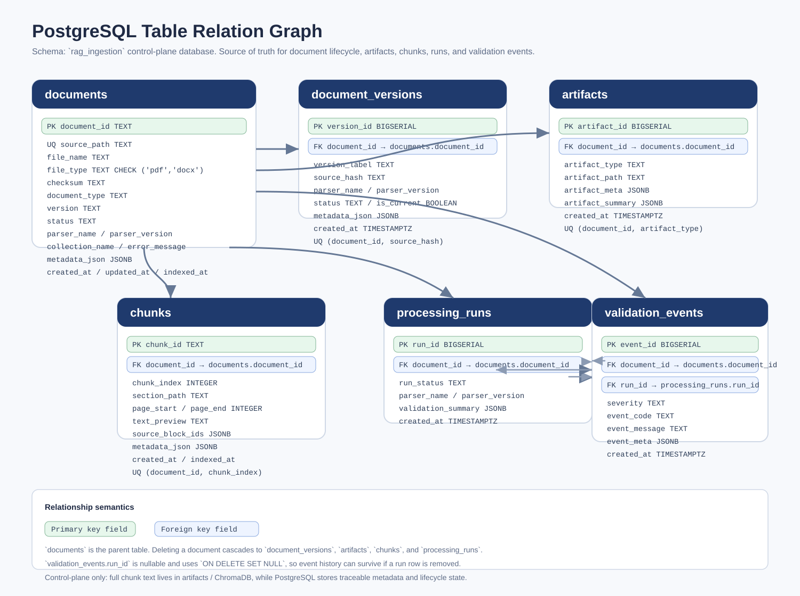

# Database Relations

This is the PostgreSQL control-plane entity relationship view for the `rag_ingestion` schema.

## Core design

- `documents` is the parent record for one registered source document in the workspace.
- `document_versions` stores version history and checksum-backed version rows for that document.
- `artifacts` stores traceable output file paths such as canonical JSON, markdown preview, and chunk artifact files.
- `chunks` stores lightweight retrieval metadata for each validated chunk.
- `processing_runs` stores ingestion and indexing run history.
- `validation_events` stores deterministic validation warnings and errors, optionally linked to a specific run.

## Key relational rules

- `document_versions.document_id` → `documents.document_id` with `ON DELETE CASCADE`
- `artifacts.document_id` → `documents.document_id` with `ON DELETE CASCADE`
- `chunks.document_id` → `documents.document_id` with `ON DELETE CASCADE`
- `processing_runs.document_id` → `documents.document_id` with `ON DELETE CASCADE`
- `validation_events.document_id` → `documents.document_id` with `ON DELETE CASCADE`
- `validation_events.run_id` → `processing_runs.run_id` with `ON DELETE SET NULL`

## Why this matters

This schema makes PostgreSQL the only control-plane source of truth for:

- upload registration
- duplicate handling
- version history
- artifact traceability
- validated chunk metadata
- run history
- validation status

ChromaDB remains only the vector store for approved chunks.
