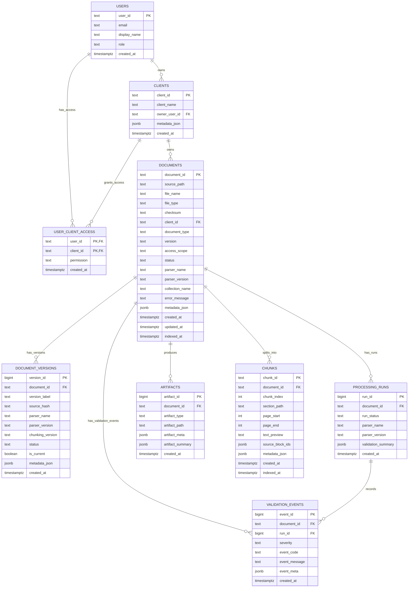

# PostgreSQL Ingestion Control Schema

## Entity Relationship Diagram

## Table Comments

| Table | Comment |
| --- | --- |
| `users` | Future application users or operators. |
| `clients` | Client or knowledge-owner scope, for example Daythree or a sample bank. |
| `user_client_access` | Permission mapping between users and client scopes. |
| `documents` | Main registry for uploaded sources and current automation status. |
| `document_versions` | Version history based on document id, version label, and source hash. |
| `processing_runs` | Parser/indexing run log with validation summary JSONB. |
| `artifacts` | Paths and lightweight summaries for generated JSON, Markdown, and chunk files. |
| `chunks` | Chunk-level tracking with `chunk_id`, order, source section, preview, and indexing state. |
| `validation_events` | Automated validation warnings, failures, and parser quality events. |
