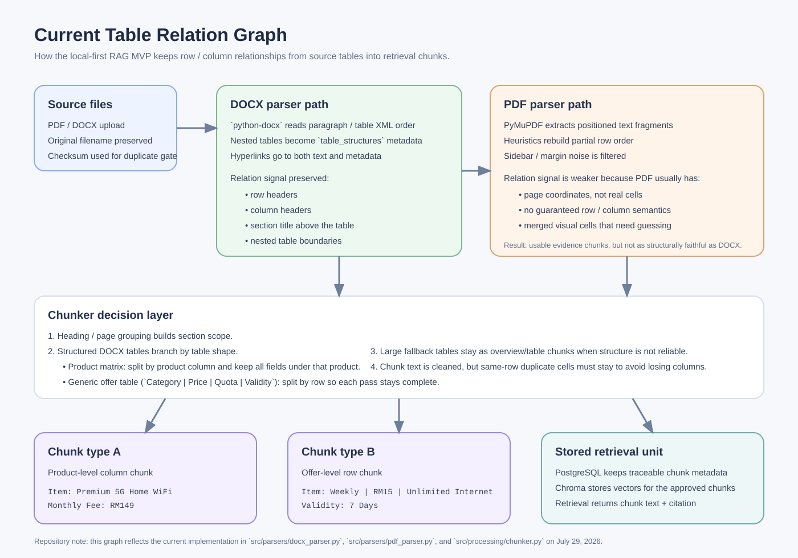

# Table Relation Graph

This graph shows how the current MVP preserves table relationships from source documents into retrieval chunks.

## What this graph is describing

- `DOCX` keeps the strongest structure because the parser can read paragraph order, tables, nested tables, and hyperlinks directly from the document XML.
- `PDF` keeps weaker structure because the parser mainly reconstructs text from page coordinates and heuristics.
- The chunker then decides whether to keep a table as:
  - a product-level column chunk
  - an offer-level row chunk
  - a fallback overview/table chunk

## Why this matters

The retrieval quality depends heavily on whether row/column relationships survive parsing and chunking. If a table is over-split or columns are misaligned, the returned chunk may still be semantically similar but no longer be the cleanest evidence unit.
